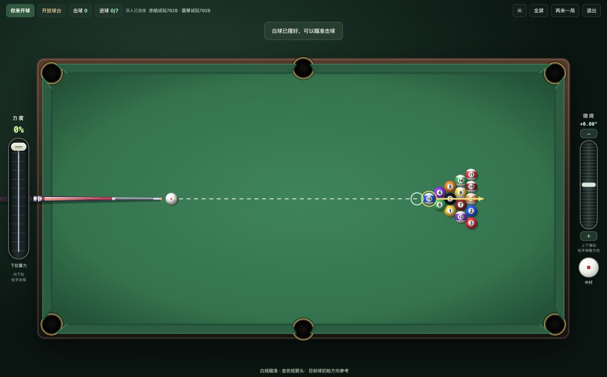

# RainBow Pool · 和朋友来一局

支持手机横屏的中文台球游戏，采用俯视球桌和三维球面。创建球桌、分享链接，两位玩家无需注册即可对打，也可以单人练球。

用昵称和密码注册后，可以在首页从六款球杆里选择。账号会记住上次选中的款式，双人房会显示入座时的昵称和球杆。

[在线体验](https://3000-agq2udpq7t7yj3auet7yeeg4fy.instabox.tech/) · [更新日志](CHANGELOG.md) · [物理模型](PHYSICS.md) · [部署说明](DEPLOY.md) · [参与贡献](CONTRIBUTING.md)

示例部署使用免费云主机，可能休眠或暂时不可用。可以按下文自行部署。



## 当前功能

- 中文界面，手机横屏布局；桌面鼠标和键盘也可操作。
- 六位房间码与邀请链接，每张球桌最多两位玩家。
- 服务器统一计算物理、开球、定组、自由球和黑 8 胜负；支持断线重连及房间存档。
- 可见球杆、左侧独立力度条、右侧角度微调，以及白球击点控制。
- 三维球面随自转滚动。球号、花色条纹和白球红点会转到侧面或背面，停球后保留当时的朝向。联机双方会收到相同的球面朝向。
- 高低杆、左右塞、滑动/滚动摩擦、球碰球和库边碰撞；袋口斜边参与实际碰撞。
- 稳定的短方向指引，蓄力时不晃动；白球落袋后，对手可反复摆放自由球并确认。
- 联机运动显示补帧、按变化更新记分栏和拥塞时的中间快照限流。

## 快速运行

需要 **Node.js 22.12 或更新版本**，建议使用 `.nvmrc` 指定的 Node.js 22。

```sh
git clone https://github.com/sSs-Lucky/rainbow-pool.git
cd rainbow-pool
npm ci
npm run build
npm start
```

浏览器打开 `http://localhost:3000`。创建房间后，把邀请链接发给能访问该地址的另一位玩家。

手机和朋友通过公网游玩，需要将服务部署到可访问的主机，并配置支持 WebSocket 的 HTTPS 入口。项目包含 Node.js 服务，单独发布 `dist/` 不能提供当前的双人对战。

## 怎么玩

| 操作 | 方法 |
| --- | --- |
| 粗瞄 | 在球桌上点击或拖动，调整击球方向 |
| 精调 | 右侧竖条上下拖动；＋/− 每次调整 0.05° |
| 击球 | 左侧力度条向下拉，松手出杆；推回起点取消 |
| 加塞 | 点击右下白球，拖动红点；支持组合高低杆与左右塞，每杆后自动回中 |
| 方向参考 | 白线指向接触位置，金色短箭头提示目标球的初始方向；不表示完整行程 |
| 黑 8 袋口 | 清完本组后点击指定袋口，或用下方菜单选择，再打黑 8 |
| 自由球 | 在允许区域点击或拖动白球，确认后再出杆。开球摆白球限左侧开球线后 |

双人模式参考 [WPA 国际八球第 4 章](https://wpapool.com/wp-content/uploads/2026/10/WPA-Rules-2026-10-21-211.pdf#page=18) 的开球和犯规规则。首局随机分配开球权，再来一局时轮换。合法开球进球可以续杆，球桌仍然开放。

普通球可以直接出杆。开球后首次合法进球决定全色 1–7 或花色 9–15，同杆进两组以先入袋的球为准。清完本组后选择黑 8 的袋口，合法打入指定袋口获胜。

开球没进球且少于四颗不同的目标球碰库时，由对手选择继续或重开。开球黑 8 入袋可复位或重开。开球白球落袋后，对手在开球线后摆白球；普通犯规的自由球可在全台摆放。游戏采用随机开球代替比赛的比球，物理模型限制球心在台面内运动。

方向箭头基于固定参考击球求得的初始方向，实际效果还受力度、加塞及后续碰撞影响。

物理模型让球心沿台面运动，并计算绕三个轴的自转。WebGL 根据自转绘制三维球面，其他渲染器使用静态球面。模型采用贴台球与水平球杆的刚体近似，适用范围见 [物理模型说明](PHYSICS.md)。

## 本地开发

先执行快速运行中的依赖安装与构建。开发时使用两个终端：

```sh
npm start
```

```sh
npm run dev
```

打开 Vite 显示的本地地址（通常为 `http://127.0.0.1:5173`）。Vite 将 `/ws` 和 `/health` 转发到本机 3000 端口的服务端，因此开发模式也能测试邀请对战。Vite 开发服务用于本机调试。

## 检查与测试

```sh
npm test
npm run build
```

启动服务后，执行真实双客户端测试：

```sh
POOL_TEST_URL=http://127.0.0.1:3000 npm run test:network
```

`npm test` 包含物理、瞄准、规则及显示推演检查。联网测试覆盖双人入座、球面朝向同步、开球、普通进球定组、自由球、房间隔离及断线重连。GitHub Actions 在提交和 Pull Request 时自动运行测试与构建。

## 配置

| 变量 | 默认值 | 作用 |
| --- | --- | --- |
| `PORT` | `3000` | HTTP/WebSocket 监听端口 |
| `HOST` | `0.0.0.0` | 监听地址 |
| `POOL_DATA_DIR` | 项目下 `.runtime` | 服务端房间存档目录 |

可通过宿主环境或服务管理器设置变量。也可以复制 `.env.example` 为 `.env`，使用 `node --env-file=.env server.mjs` 启动；普通 `npm start` 不会自动加载 `.env`。

`.runtime` 包含房间状态、席位凭据和账号存档，已排除在 Git 之外。迁移部署时保留整个数据目录。个人部署记录使用本地 `deployment.json`，公开仓库只提供 `deployment.example.json`。房间存档当前为物理版本 3，未来物理格式升级可能需要重摆旧球桌。

## 项目结构

```text
src/main.js          游戏循环、输入与客户端状态
src/scene.js         PixiJS 绘制与方向指引
src/ball-visual.js   WebGL 三维球面、花色和号码
src/orientation.js   根据角速度更新球面朝向
src/aiming.js        接触位置与初始方向参考
src/physics.js       共享物理求解器
src/geometry.js      绘制与碰撞共用的库边、袋口几何
src/shot-rules.js    服务端使用的击球判罚
src/playback.js      联机快照之间的显示推演
src/net.js          同源 WebSocket 与重连
server.mjs          HTTP、房间、权威状态和存档
public/sfx/         音效及来源声明
test/               单元、物理、规则与联网测试
deploy/             通用部署模板
```

## 开源与致谢

本项目基于 [Arel Kair / Pool](https://github.com/arelkair/pool) 二次开发，上游基准提交为 `f1c0017e219d72bb7c7f1c75bd7db9d3c6d88a88`。保留原作者版权与 [MIT LICENSE](LICENSE)。改造内容包括中文手机操控、服务器统一对战、旋转与摩擦、袋口几何、自由球和稳定方向指引等；来源与变更范围见 [UPSTREAM.md](UPSTREAM.md)。

音效使用上游记录的 CC0 资源，来源声明保留在 [public/sfx/CREDITS.txt](public/sfx/CREDITS.txt)。界面中的球桌、球杆、球体和控件由项目代码绘制，未包含商业台球小游戏的截图、贴图或品牌资产。
